# 🌐 Awesome Cloud-Native Networking & Security 🛡️

  

  
  
  
  
  
  

---

## ⚡ Top Cloud-Native Networking & Security Ecosystem

**Curated Directory of Enterprise SaaS Solutions & Production-Grade Open-Source GitHub Projects**  
*Comprehensive landscape covering eBPF Dataplanes, Microsegmentation, Service Meshes, Kubernetes CNI, Zero Trust, and Cloud-Native Application Protection Platforms (CNAPP).*  

📅 **Last updated: October 2026**

---

### 📖 Overview & Mission

Welcome to the definitive, SEO-optimized directory tracking leading **SaaS platforms** and **open-source repositories** in the **Cloud-Native Networking & Security** landscape. As modern infrastructure transitions toward Kubernetes clusters, microservices, and hybrid multi-cloud topologies, perimeter security has evolved into identity-driven, workload-level microsegmentation and high-throughput kernel-level observability.

These tools empower platform engineers, Site Reliability Engineers (SREs), DevSecOps practitioners, and security analysts to:
- 🚀 **Accelerate Container Networking**: Bypass legacy `iptables` and `kube-proxy` bottlenecks using high-performance eBPF dataplanes.
- 🔒 **Enforce Granular Zero-Trust Policies**: Implement Layer 3, Layer 4, and Layer 7 identity-based access control policies across distributed pods.
- 🛡️ **Detect Threats in Real Time**: Monitor kernel syscalls, detect anomalies, block container escapes, and prevent lateral attacks.
- 📊 **Automate Posture Management & Compliance**: Scan configurations against CIS benchmarks, NSA/CISA standards, SOC 2, and MITRE ATT&CK frameworks.

---

## 📑 Table of Contents

- [📊 Sector Overview & Market Dynamics](#-sector-overview--market-dynamics)
- [🏢 SaaS & Commercial Platforms](#-saas--commercial-platforms)
- [🔓 Open-Source GitHub Projects](#-open-source-github-projects)
- [📈 Star History](#-star-history)
- [🤝 How to Contribute](#-how-to-contribute)
- [💖 Support & Sponsorship](#-support--sponsorship)
- [⚠️ Disclaimer](#️-disclaimer)

---

## 📊 Sector Overview & Market Dynamics

The cloud-native networking and security market—spanning Cloud-Native Application Protection Platforms (CNAPP), eBPF dataplanes, and multi-cloud networking—is valued at approximately **$9.4B to $14.5B** and projected to surpass **$50B+ by the early 2030s** at an estimated CAGR of **24%–28%**. The sector is **moderately to highly fragmented**, characterized by high-velocity coexistence and ongoing consolidation between hyper-scale infrastructure conglomerates (Broadcom, Cisco, IBM/Red Hat), pure-play cloud security pioneers (Palo Alto Networks, Sysdig, Aqua Security), and open-source enterprise distributions.

---

## 🏢 SaaS & Commercial Platforms

| Platform | Company Valuation / Revenue | Starting Pricing Tier | Free Tier / Trial Limits | Description |
| :--- | :--- | :--- | :--- | :--- |
| **[VMware NSX](https://www.vmware.com/)** | **~$1.65T** (Broadcom parent market cap) | ~$90 – $115 per core/year (via VMware Cloud Foundation subscription; 16 cores/CPU minimum) | **60-day free evaluation** (enterprise trial with full feature access via Broadcom portal) | Enterprise network virtualization and security platform with container networking via NSX Container Plugin (NCP) for vSphere & Tanzu. |
| **[Isovalent Enterprise Cilium (Cisco)](https://isovalent.com/)** | **~$430B** (Cisco parent market cap; acquired for ~$650M) | ~$600 per node/year (Enterprise Essentials tier, annual commit) | **Free interactive sandbox labs** (guided browser sessions at isovalent.com/labs with no cluster limits; custom 30-day enterprise PoC on request) | Enterprise version of Cilium with troubleshooting, operational support, multi-cluster Cluster Mesh, and commercial eBPF networking. |
| **[Palo Alto Prisma Cloud](https://www.paloaltonetworks.com/prisma/cloud)** | **~$310B** (Market Cap) | ~$18,000/year (or ~$1.20 per credit; 2 credits/VM for Foundations, 5 credits/VM for Advanced) | **30-day free trial** (access to CSPM, CWPP, and code security modules without upfront credit card commitment) | Comprehensive CNAPP platform offering CWPP, CSPM, CIEM, WAAS, and code-to-cloud security across multi-cloud environments. |
| **[Red Hat Advanced Cluster Security (StackRox)](https://www.redhat.com/en/technologies/cloud-computing/openshift/advanced-cluster-security-kubernetes)** | **~$212B** (IBM parent market cap; acquired Red Hat for $34B) | ~$0.028 per vCPU/hour on-demand (RHACS Cloud Service via AWS Marketplace) | **60-day free trial** (self-supported trial limited to 20 cores or 80 vCPUs across Kubernetes/OpenShift clusters) | Kubernetes-native security platform featuring vulnerability management, network segmentation, risk profiling, and compliance reporting. |
| **[Dynatrace](https://www.dynatrace.com/)** | **~$18.5B** (Market Cap) | $0.00225 per memory-GiB-hour (~$13/month per 8 GiB host for Application Security) | **15-day free trial** (includes full-stack observability and runtime vulnerability analytics) | Unified observability platform featuring runtime Kubernetes vulnerability analytics, threat detection, and automated remediation. |
| **[NeuVector (SUSE)](https://neuvector.com/)** | **~$6.0B** (SUSE private equity valuation) | ~$112 per node/month (AWS Marketplace pay-as-you-go; 5–15 nodes bracket) | **Free forever open-source edition** (full Layer 7 container firewall on GitHub with no node limits; commercial NeuVector Prime features a 30-day eval) | Full lifecycle container security platform featuring Layer 7 container firewall, deep packet inspection, and process profiling. |
| **[Sysdig Secure](https://sysdig.com/)** | **~$2.5B** (Valuation at Series G) | $72 per host/month (CNAPP Enterprise tier, 20-host minimum commitment) | **30-day free trial** (full runtime threat detection, Falco rules engine, and CSPM features) | Cloud-native security platform with deep runtime threat detection, vulnerability management, and forensics powered by Falco. |
| **[Aqua Security](https://www.aquasec.com/)** | **~$1.0B+** (Valuation at Series E) | ~$35 – $55 per workload/month (Enterprise list price; or ~$10,000/year entry package) | **14-day free trial** (full CNAPP workload protection evaluation; unlimited free open-source scanner via Trivy) | Cloud-native security platform covering vulnerability scanning, container runtime protection, secrets management, and compliance. |
| **[Tigera Calico Enterprise](https://www.tigera.io/)** | **~$250M – $350M** (Estimated; $53M total VC funding raised) | $0.025 per vCPU/hour (Calico Cloud consumption billing via AWS/Azure Marketplace) | **Free forever plan** (strictly 1 connected Kubernetes cluster running Calico OSS 3.30+, includes 24-hr flow log retention and service graph) | Self-managed and SaaS platform for Kubernetes networking, hierarchical tiered network policies, SIEM integrations, and workload-centric WAF. |

---

## 🔓 Open-Source GitHub Projects

*Sorted descending by repository GitHub stars count. Each star badge links directly to that repository's stargazers page.*

1. **[Trivy](https://github.com/aquasecurity/trivy)**   
   **Comprehensive security scanner for vulnerabilities, misconfigurations, secrets, and SBOMs** (Apache-2.0). Scans container images, filesystems, Git repositories, virtual machine disks, Kubernetes clusters, and Infrastructure as Code (Terraform, CloudFormation). The de facto default scanner for DevSecOps CI/CD pipelines.

2. **[Istio](https://github.com/istio/istio)**   
   **Connect, secure, control, and observe services** (Apache-2.0). CNCF Graduated service mesh providing transparent mTLS encryption, fine-grained L7 traffic routing, fault injection, authorization policies, and distributed telemetry across multi-cluster environments with ambient mesh sidecarless mode.

3. **[Envoy](https://github.com/envoyproxy/envoy)**   
   **Cloud-native high-performance edge/middle/service proxy** (Apache-2.0). CNCF Graduated proxy powering modern cloud-native networking dataplanes, ingress controllers, API gateways, and service meshes with dynamic configuration via discovery APIs (xDS), advanced load balancing, and L7 observability.

4. **[Cilium](https://github.com/cilium/cilium)**   
   **eBPF-based Networking, Security, and Observability** (Apache-2.0). CNCF Graduated project and the industry reference standard for container network interfaces (CNI). Provides kernel-level L3/L4/L7 identity-based NetworkPolicy enforcement, high-throughput service load balancing bypassing kube-proxy, multi-cluster Cluster Mesh, transparent encryption via WireGuard/IPsec, and mutual authentication.

5. **[Open Policy Agent (OPA)](https://github.com/open-policy-agent/opa)**   
   **Open-source, general-purpose policy engine** (Apache-2.0). CNCF Graduated project establishing the standard for policy-as-code across the cloud-native ecosystem. Decouples policy decision-making from software using the declarative Rego query language for Kubernetes admission control, microservices authorization, API gateways, and CI/CD pipelines.

6. **[Kubescape](https://github.com/kubescape/kubescape)**   
   **Kubernetes security posture management (KSPM)** (Apache-2.0). CNCF Sandbox project that assesses Kubernetes clusters, YAML manifests, and Helm charts against hardening guidelines including NSA/CISA, CIS Benchmark, SOC 2, and MITRE ATT&CK. Offers automated risk profiling, RBAC visualization, image vulnerability scanning, and network policy generation.

7. **[Linkerd2](https://github.com/linkerd/linkerd2)**   
   **Ultralight, security-first service mesh for Kubernetes** (Apache-2.0). CNCF Graduated service mesh written in Rust and Go. Delivers automatic zero-config mutual TLS (mTLS), transparent proxying, L7 metrics, traffic splitting, and policy enforcement with minimal CPU/memory overhead.

8. **[Falco](https://github.com/falcosecurity/falco)**   
   **Cloud-native runtime security and behavioral monitoring** (Apache-2.0). CNCF Graduated project and standard for runtime threat detection. Leverages Linux kernel syscall tracing and modern eBPF probes to detect unexpected behavior, privilege escalation, shell spawns, container escapes, and namespace changes in real time with an extensive library of MITRE-mapped rules.

9. **[Kyverno](https://github.com/kyverno/kyverno)**   
   **Kubernetes-native policy management** (Apache-2.0). CNCF Incubating admission controller that validates, mutates, generates, and verifies Kubernetes resources using native Kubernetes YAML declarations. Supports image signing verification via Sigstore Cosign, software supply chain checks, and fine-grained cluster governance without requiring custom DSLs.

10. **[Kube-bench](https://github.com/aquasecurity/kube-bench)**   
    **CIS Kubernetes Benchmark auditing tool** (Apache-2.0). Checks whether Kubernetes is deployed securely by running tests documented in the CIS Kubernetes Benchmark against master and worker node configurations, etcd security, API server parameters, and kubelet permissions.

11. **[Fluent Bit](https://github.com/fluent/fluent-bit)**   
    **Fast and lightweight telemetry processor and forwarder** (Apache-2.0). CNCF Graduated logging and security telemetry agent. Essential for routing Kubernetes audit logs, container runtime outputs, network flow logs, and SIEM security events with negligible resource consumption.

12. **[Calico Open Source](https://github.com/projectcalico/calico)**   
    **Cloud-native networking and network security** (Apache-2.0). Widely adopted container networking interface (CNI) supporting Kubernetes, OpenShift, OpenStack, and bare metal. Features native BGP peering with enterprise top-of-rack switches, modular dataplanes (eBPF, Linux iptables, Windows HNS, VPP), WireGuard point-to-point encryption, and strict hierarchical policy enforcement.

13. **[Cosign (Sigstore)](https://github.com/sigstore/cosign)**   
    **Container signing, verification, and storage in OCI registries** (Apache-2.0). OpenSSF / Linux Foundation standard for software supply chain security. Enables cryptographically signing container images, verifying signatures, attesting SBOMs, and enforcing admission policies before pods enter production clusters.

14. **[Kube-hunter](https://github.com/aquasecurity/kube-hunter)**   
    **Kubernetes penetration testing and vulnerability hunting tool** (Apache-2.0). Proactively scans running clusters for security weaknesses, misconfigured etcd ports, open kubelet APIs, credential leakage, and attack vectors from both outside and inside the cluster.

15. **[Tetragon](https://github.com/cilium/tetragon)**   
    **eBPF-based security observability and runtime enforcement** (Apache-2.0). Part of the Cilium ecosystem. Operates directly within the Linux kernel to monitor process execution, file access, socket calls, and network activity with real-time in-kernel preventative enforcement and kill capabilities.

16. **[Parca](https://github.com/parca-dev/parca)**   
    **Continuous profiling for Linux and cloud-native applications** (Apache-2.0). Leverages eBPF to continuously measure CPU and memory usage down to exact lines of code across all running containers and kernel subsystems without code instrumentations or runtime overhead.

17. **[Hubble](https://github.com/cilium/hubble)**   
    **Distributed networking and security observability for Cilium** (Apache-2.0). Built on top of Cilium and eBPF to deliver deep network traffic visibility, service dependency maps, DNS resolution metrics, TCP connection latencies, and real-time alerts on policy-blocked packets.

18. **[Gatekeeper](https://github.com/open-policy-agent/gatekeeper)**   
    **Policy controller for Kubernetes using OPA** (Apache-2.0). Integrates Open Policy Agent as a validating and mutating admission controller. Provides parameterized policy templates (ConstraintTemplates), cluster auditing, and dry-run policy rollouts.

19. **[KubeLinter](https://github.com/stackrox/kube-linter)**   
    **Static analysis tool for Kubernetes YAML files and Helm charts** (Apache-2.0). Analyzes Kubernetes configurations before deployment to verify adherence to security best practices, non-root execution, privilege escalation denial, and resource limit configurations.

20. **[Polaris](https://github.com/FairwindsOps/polaris)**   
    **Kubernetes configuration validation and best-practice engine** (Apache-2.0). Provides a web dashboard and admission webhook to assess cluster health, security contexts, network policy coverage, and efficiency guidelines.

21. **[KubeArmor](https://github.com/kubearmor/KubeArmor)**   
    **Cloud-native runtime security enforcement system** (Apache-2.0). CNCF Sandbox project leveraging Linux Security Modules (AppArmor, SELinux, BPF-LSM) to restrict process execution, sensitive file access, and network socket operations at the system level for containers, microVMs, and bare-metal nodes.

22. **[Trivy Operator](https://github.com/aquasecurity/trivy-operator)**   
    **Kubernetes-native security toolkit** (Apache-2.0). Continuously monitors Kubernetes clusters by turning scanner results into native Kubernetes Custom Resource Definitions (CRDs) for automated vulnerability tracking, exposed secrets, and configuration auditing.

23. **[NeuVector Open Source](https://github.com/neuvector/neuvector)**   
    **Open-source, container-native Layer 7 network security and compliance** (Apache-2.0). Sourced from SUSE NeuVector. Delivers deep packet inspection (DPI), dynamic Layer 7 container firewalls, automated behavioral profiling, admission control, and DLP protection without per-node fees.

24. **[StackRox](https://github.com/stackrox/stackrox)**   
    **Kubernetes-native security platform** (Apache-2.0). Open-source codebase underpinning Red Hat Advanced Cluster Security (RHACS). Provides unified vulnerability management, risk profiling, declarative network segmentation, and automated compliance auditing across OpenShift and Kubernetes.

25. **[in-toto](https://github.com/in-toto/in-toto)**   
    **Framework to protect the integrity of the software supply chain** (Apache-2.0). CNCF Graduated project that verifies every step in software creation and distribution from commit to cluster rollout, guarding against tampering, untrusted build steps, and unauthorized pipeline injections.

---

### 🧩 Blueprint for a Complete Open-Source Security Stack

You can combine these modular open-source projects into an enterprise-grade, zero-trust cloud-native platform:
- **Dataplane & CNI**: **Cilium** or **Calico** for high-throughput pod networking and L3/L4/L7 policies.
- **Service Mesh & Zero Trust**: **Istio** or **Linkerd2** for sidecarless/sidecar transparent mTLS and traffic shaping.
- **Runtime Threat Detection**: **Falco** for behavioral anomaly detection and kernel event monitoring.
- **Runtime Enforcement**: **Tetragon** or **KubeArmor** for in-kernel blocking and LSM-based security.
- **Policy-as-Code & Admission**: **Kyverno** or **OPA Gatekeeper** to reject non-compliant manifests.
- **Vulnerability & Supply Chain**: **Trivy**, **Cosign**, and **in-toto** for scanning and cryptographic image signing.
- **Audit & Posture Management**: **Kubescape** and **Kube-bench** for continuous compliance with CIS & NSA frameworks.

---

## 📈 Star History

---

## 🤝 How to Contribute

Contributions are welcome and highly appreciated! To contribute:

1. 🍴 **Fork the repository** on GitHub.
2. 🌿 **Create a new branch** (`git checkout -b feature/add-new-tool`).
3. ✏️ **Add or update entries** in `README.md` following the established format (include license, links, star badges for open-source repos, and concise technical summaries).
4. 📬 **Submit a Pull Request** with a brief rationale for the addition.
5. ⭐ **Star the repo** if you find it helpful!

---

## 💖 Support & Sponsorship

If you find this curated directory helpful for your team, platform architecture, or research, please consider supporting the project:

- ⭐ **Star this repository** and share it with your DevOps, Platform, and SecOps peers!
- ☕ **Sponsor or buy a coffee**: Support ongoing curation, open-source benchmarking, and updates directly via the [GitHub Sponsor Dashboard](https://github.com/sponsors/ishandutta2007).

---

## ⚠️ Disclaimer

- This list is **community-curated** for educational, architectural, and informational purposes—it is not an exhaustive vendor endorsement.
- Cloud-native networking and security tools handle sensitive network packets, cluster configurations, and workload telemetry. Always implement strict principle-of-least-privilege access and test policies in staging environments before deploying to production clusters.
- Open-source solutions require appropriate Linux kernel versions (eBPF capabilities typically require Linux kernel 5.4+, with 5.10+ strongly recommended for complete BPF-LSM and ring-buffer features).

---

  <b>Built with ❤️ for platform engineers, security teams, and cloud architects worldwide.</b> 
  <i>Let's make Cloud-Native Networking &amp; Security transparent, zero-trust, and observable.</i>

# Awesome-Cloud-Native-Networking-Security

